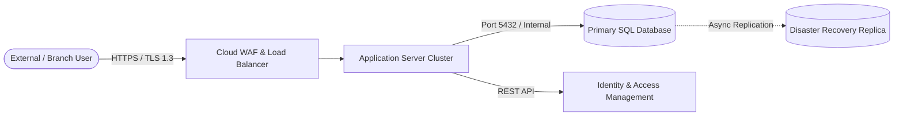

# Enterprise Infrastructure & Traffic Flow Architecture

High-level system architecture illustrating external client ingress, perimeter security, application tier routing, and asynchronous database replication.

